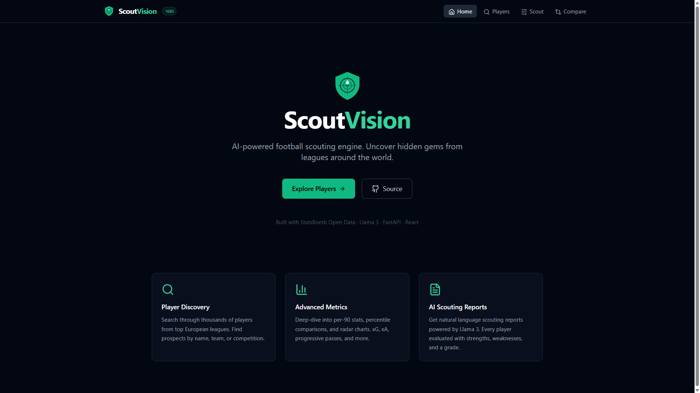
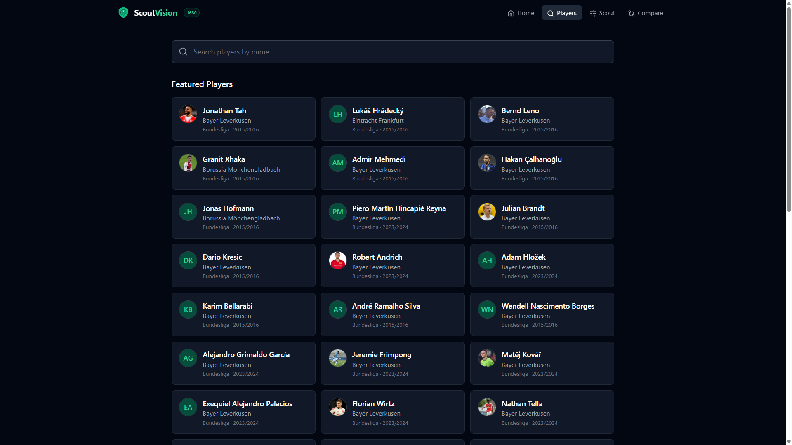
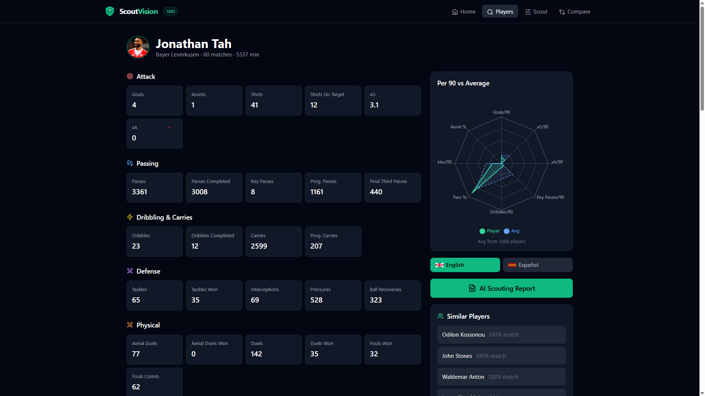
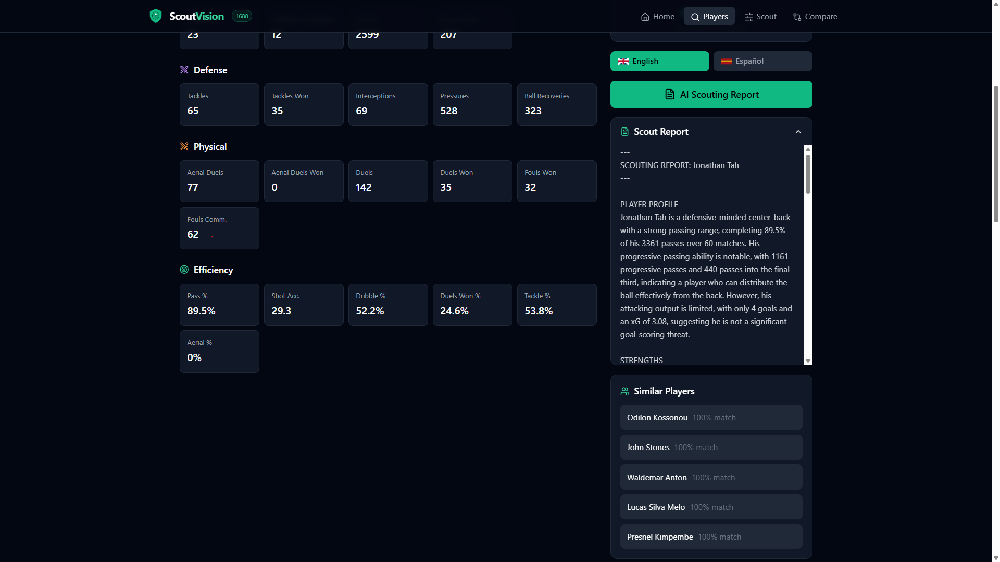
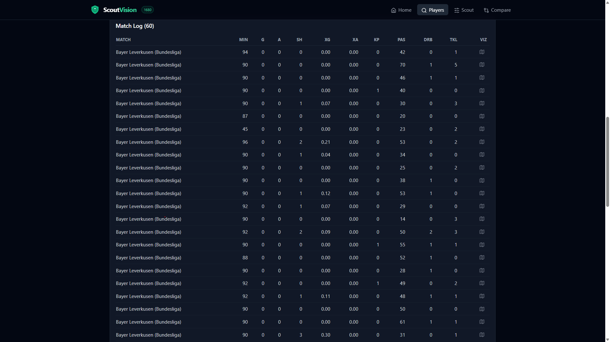
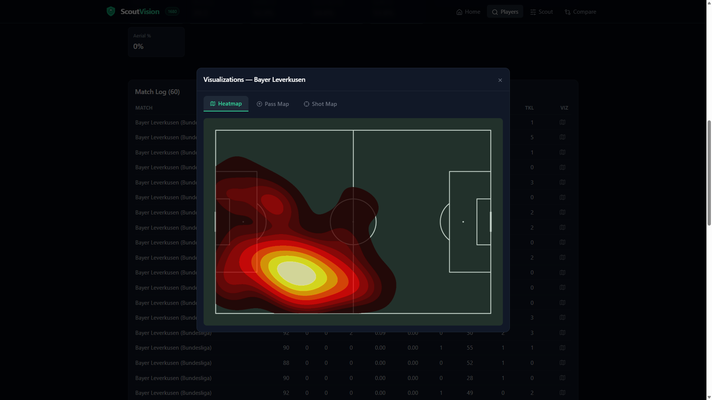
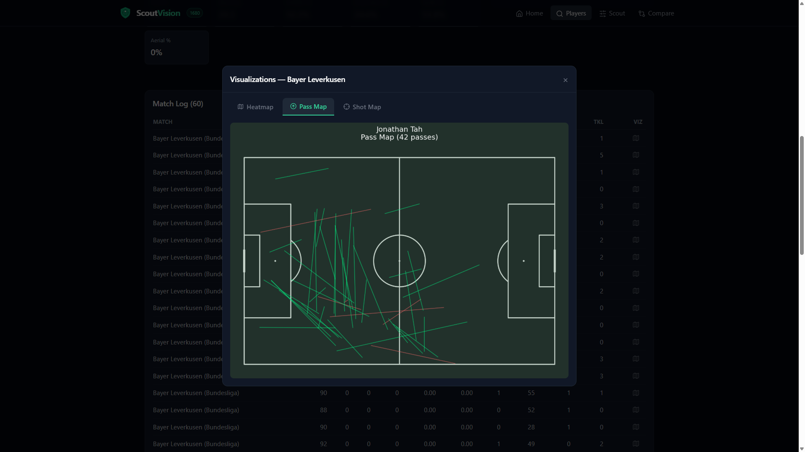
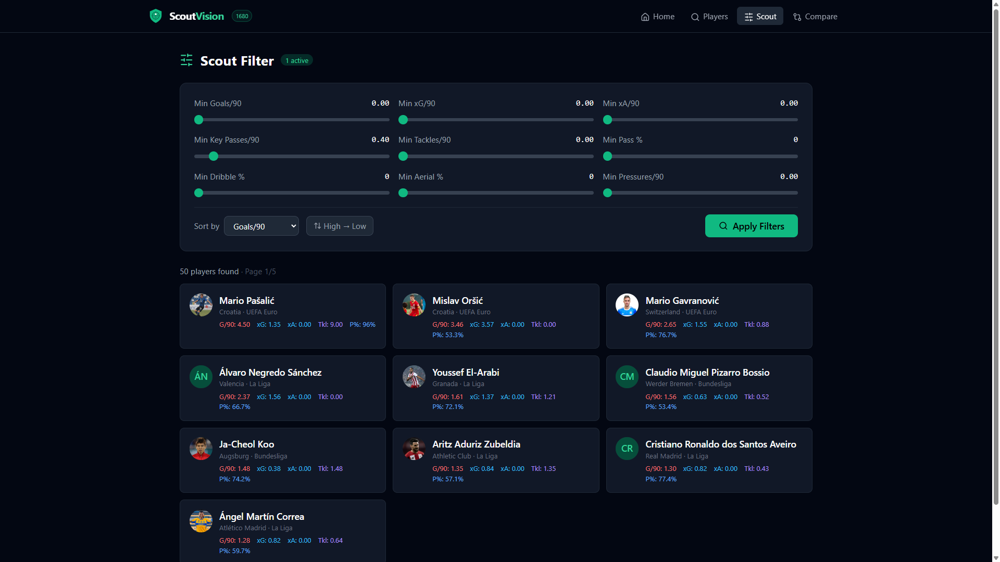
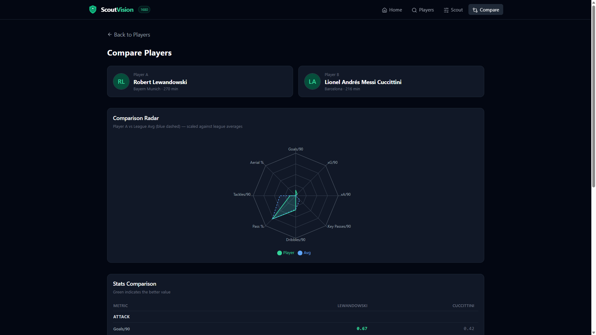
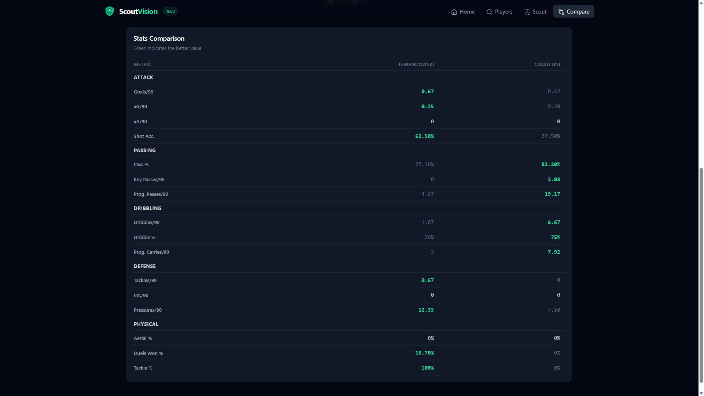

<div align="center">
  
  
  
  
  
  
</div>

<br />

<p align="center">
  
</p>

# ScoutVision AI ⚽🧠

ScoutVision AI is a football scouting platform built around open match data, advanced metrics, tactical visualizations, and AI-generated reports.

It takes raw StatsBomb data and turns it into something closer to a real scouting workflow: player search, profile analysis, comparisons, similarity discovery, match-level visualizations, and narrative reports powered by Llama 3 through Groq.

## Overview

The idea behind ScoutVision is simple: combine football data and AI in a way that feels useful, practical, and accessible.

Instead of building a generic stats dashboard, the project focuses on a scouting perspective:
- Find players quickly.
- Understand how they perform across matches.
- Compare profiles side by side.
- Visualize actions on the pitch.
- Generate structured scouting reports in English or Spanish.

## Highlights

- Real StatsBomb Open Data ingestion for matches, events, and lineups
- Advanced player metrics including xG, xA, progressive actions, pressures, duels, and efficiency stats
- Tactical visualizations such as heatmaps, pass maps, and shot maps
- AI scouting reports generated with Llama 3.3 70B via Groq
- Similar player discovery with vector-based comparisons
- Interactive scouting dashboard built with React, Vite, and Tailwind
- 100% free stack using open data and free-tier compatible services

## Product Demo

### 1. Home
<p align="center">
  
</p>

Landing page with the platform's core value proposition: player discovery, advanced metrics, and AI scouting reports.

### 2. Players
<p align="center">
  
</p>

Players section right after entering, showing the featured players list before any search or selection.

### 3. Player profile
<p align="center">
  
</p>

Individual player profile with aggregated stats across attacking, passing, dribbling, defensive, and physical categories.

### 4. AI scouting report
<p align="center">
  
</p>

Lower section of the player profile showing the AI-generated scouting report in English, with strengths, weaknesses, and statistical assessment.

### 5. Match log
<p align="center">
  
</p>

Match log view listing all matches played by the selected player with per-match stats.

### 6. Heatmap
<p align="center">
  
</p>

Heatmap visualization for a specific match, showing the player's positioning and activity zones on the pitch.

### 7. Pass map
<p align="center">
  
</p>

Pass map visualization for the same match, displaying completed and incomplete passes across the pitch.

### 8. Scout filters
<p align="center">
  
</p>

Scout mode filtering players by a minimum threshold of Key Passes/90 set to 0.40, returning matching players from the pool.

### 9. Player comparison
<p align="center">
  
</p>

Compare page with Robert Lewandowski and Lionel Messi selected as Player A and Player B.

### 10. Stats comparison
<p align="center">
  
</p>

Second part of the compare view, showing the side-by-side stats comparison between Messi and Lewandowski.

## Architecture

```text
┌──────────────┐     ┌──────────────────┐     ┌────────────────┐
│  StatsBomb   │────▶│  Python/FastAPI  │────▶│  React + Vite  │
│  Open Data   │     │  + Llama 3/Groq  │     │  + Tailwind    │
└──────────────┘     └──────────────────┘     └────────────────┘
                          │                           │
                    ┌─────┴──────┐              ┌─────┴──────┐
                    │  Pandas    │              │  Recharts  │
                    │  mplsoccer │              │  Lucide    │
                    │  Groq SDK  │              │  Dark Mode │
                    └────────────┘              └────────────┘
```

## Core Features

### Player search and profiles
Search players from the StatsBomb dataset and open detailed profiles with aggregated match data, efficiency metrics, and per-90 stats.

### AI scouting reports
Generate structured reports in English or Spanish with strengths, improvement areas, statistical assessment, and a final scouting verdict.

### Similar player discovery
Find players with comparable profiles using vector-based similarity across key performance metrics, with support for position-aware filtering.

### Match visualizations
Inspect individual matches through pitch-based visualizations such as heatmaps, pass maps, and shot maps.

### Comparison tools
Compare two players side by side to quickly understand stylistic and statistical differences.

### Scout mode
Filter the player pool using thresholds such as xG per 90, xA per 90, key passes, tackles, pass accuracy, dribble success, aerial success, and pressures.

## Available Metrics

| Category | Metrics |
|---|---|
| Attacking | Goals, shots, shots on target, xG, assists, xA, shot accuracy |
| Passing | Passes, pass completion, key passes, progressive passes, passes into final third, crosses, through balls |
| Ball carrying | Dribbles, dribbles completed, progressive carries |
| Defending | Pressures, tackles, tackle success, interceptions, clearances, blocks |
| Duel play | Duels, duel success, aerial duels, aerial success |
| Derived stats | Per-90 metrics, percentage efficiency metrics, similarity vectors |

## Tech Stack

| Layer | Technology |
|---|---|
| Data | StatsBomb Open Data |
| Backend | Python, FastAPI, Pandas, Scikit-learn |
| AI | Llama 3.3 70B via Groq API |
| Visualizations | mplsoccer, Matplotlib, Recharts |
| Frontend | React, Vite, Tailwind CSS, TypeScript, Lucide |
| CI | GitHub Actions |
| Deployment | Render, Vercel |

## Project Structure

```text
ScoutVision/
├── backend/
│   ├── app/
│   │   ├── api/
│   │   ├── core/
│   │   ├── services/
│   │   └── visualizations/
│   ├── data/          # runtime cache, not versioned
│   ├── sample_data/   # small committed sample (offline runs and CI)
│   └── tests/
├── docs/
├── frontend/
│   ├── public/
│   └── src/
└── docker-compose.yml
```

## Quick Start

### Requirements

- Python 3.12+
- Node.js 18+
- A free [Groq API key](https://console.groq.com)

### Backend

```bash
cd backend
python -m venv .venv
source .venv/bin/activate
pip install -r requirements.txt
cp .env.example .env
uvicorn app.main:app --reload
```

On Windows:

```bash
cd backend
python -m venv .venv
.venv\Scripts\activate
pip install -r requirements.txt
copy .env.example .env
uvicorn app.main:app --reload
```

Set your `GROQ_API_KEY` inside `.env` before generating AI reports.

### Frontend

```bash
cd frontend
npm install
npm run dev
```

Then open [http://localhost:5173](http://localhost:5173).

### Docker

```bash
docker compose up --build
```

Docker starts in offline demo mode using `backend/sample_data`. Set `DEMO_MODE=false` in `.env` to use the full StatsBomb cache in `backend/data`. Requires Docker Compose v2.24+ (optional `env_file` entry).

- Frontend: [http://localhost:5173](http://localhost:5173)
- Backend: [http://localhost:8000](http://localhost:8000) (docs at `/docs`)

The backend image does not bundle the StatsBomb event cache; `backend/data` is mounted into the container at runtime. `backend/.env` is optional — without a Groq key the app works and only AI reports are unavailable.

## Data

`backend/data` is a runtime cache: each StatsBomb file is downloaded on first use and written there. A full build is about 1.8 GB, so it is never committed.

`backend/sample_data` is the small slice that *is* committed (~11 MB: league and player index, competitions, fixtures, metrics for 50 players, and one match with events). Running against it makes everything work with no network and no downloads:

```bash
cd backend
STATSBOMB_DATA_DIR=sample_data uvicorn app.main:app --reload
```

Set `DEMO_MODE=true` to prevent StatsBomb downloads and use only files in the sample; missing data returns as unavailable. Leave it false for normal use: the API then reads and fills `backend/data` from StatsBomb Open Data on demand. CI runs the tests against the sample.

## Environment Variables

Backend `.env`:

```env
GROQ_API_KEY=your_key_here
# Optional: comma-separated allowed origins (default: http://localhost:5173)
# CORS_ORIGINS=https://your-frontend.vercel.app
# Optional: use the included offline dataset without downloads
# DEMO_MODE=true
# STATSBOMB_DATA_DIR=sample_data
```

Frontend `.env.local` (only needed when the API is on a different origin, e.g. Vercel + Render):

```env
VITE_API_BASE_URL=https://your-backend.onrender.com/api/v1
VITE_HEALTH_URL=https://your-backend.onrender.com/health
```

When both services share an origin, leave these unset: the app uses `/api/v1` and `/health`, which work through the Vite dev proxy and the nginx proxy in Docker. Remember to add the deployed frontend origin to `CORS_ORIGINS` on the backend.

## Quality and Tooling

- Automated CI with GitHub Actions
- Backend test suite with pytest
- Rate limiting enabled in the API
- Health check endpoint available at `/health`
- Vector database persisted locally for faster similarity startup
- Error boundary and defensive UI states on the frontend

## Why this project

ScoutVision was built as a portfolio project around two interests: football and AI.

The goal was not just to display statistics, but to build a small end-to-end product with a real backend, real data processing, practical frontend UX, and AI features that feel integrated into the workflow instead of bolted on.

## Roadmap

Planned ideas that could be explored later:
- Team-level scouting views
- More competitions and datasets
- Exportable PDF scouting reports
- Player role classification
- Authentication and saved shortlists

## License

MIT

---

<p align="center">
  Built with care for football, data, and product thinking
</p>